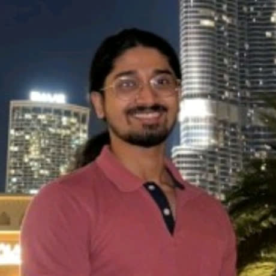
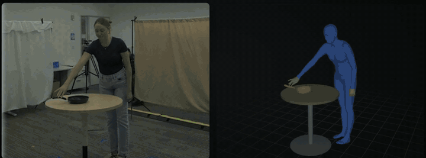

# Bhashwar Ghosh

**Founder, [Aelior Labs](https://aeliorlabs.com). Physical AI for factory work.**

Previously Senior Software Engineer at NVIDIA on Metropolis · IIT Madras · San Francisco

[aeliorlabs.com](https://aeliorlabs.com) · [LinkedIn](https://www.linkedin.com/in/bhashwar-ghosh/) · [X](https://x.com/viralgineer) · [Website](https://qmicon.github.io)

---

## About

I am the founder of **Aelior Labs**, a Delaware C corp in San Francisco. We work on physical AI for manufacturing, starting with the manual steps on a factory floor that nobody measures today. One capture of that work can verify each process step now, train new workers next, and become training data for robots later.

I am working with semiconductor manufacturing enterprises right now.

Before Aelior I spent four years at NVIDIA on **Metropolis**, the video analytics platform. It takes real-time streams from hundreds of cameras and sensors and turns them into structured data you can query. I built the analytics pipelines, the vision-language and 3D perception systems that produce that data, and a deep video research agent that answers questions over long video. I also worked on a warehouse AI agent shown in the NVIDIA GTC 2025 keynote, and filed four US patent applications.

---

## What I work on

- Vision-language models over long video: retrieval, grounding and 3D spatial reasoning
- Agentic systems that combine perception models into production pipelines
- Fine-tuning and evaluating robot policies (VLA, imitation learning)
- Simulating the manufacturing tasks that standard robot benchmarks leave out

---

## Selected work

### [NVIDIA Video-to-Data Challenge](https://nvidia-isaac.github.io/video_to_data/v2d_challenge/), CoRL 2026

  
   
  Left: the single input video with my reconstruction overlaid. Right: the same body, pan and table in 3D. Input video from the <a href="https://huggingface.co/datasets/nvidia/video_to_data_challenge">NVIDIA Video-to-Data Challenge dataset</a>, CC BY 4.0.

Competing as Aelior Labs in Track 1: reconstructing 4D human-object interaction (the body, the object's shape and its motion) from a single third-person video. The toolkit ships no baseline for this track, so I built the monocular pipeline myself, from detection and segmentation (GroundingDINO, SAM 2, SAM 3.1) through object meshes (SAM 3D), depth (MoGe) and joint reconstruction (CARI4D). On top of that I added contact-aware refinement: the hand follows the held object, and the feet stay planted. On a test clip this cut body acceleration jitter from 0.52 to 0.06 cm/frame² and the frames where the handle passes through the palm from 258 to 2. I also [reported an upstream bug](https://github.com/nvidia-isaac/video_to_data/issues/179) in the challenge toolkit. The code is in a private repo for now.

### Robot learning and simulation

  
  
  

| Project | What it shows |
|---|---|
| [**vla-lab**](https://github.com/qmicon/vla-lab) | SmolVLA fine-tuned on LIBERO. **68% success on trained tasks, 3.1% on unseen tasks, 0% for the un-fine-tuned control.** A Mac-native training and evaluation harness. |
| [**genesis-lab**](https://github.com/qmicon/genesis-lab) | Agents propose manipulation tasks and a verification gate keeps the valid ones. **1.45M env-steps/s on Apple Metal.** |
| [**doorsim**](https://github.com/qmicon/doorsim) | A mobile manipulator opens six real door types and runs an errand. Whole-body control in MuJoCo. |
| [**cleansim**](https://github.com/qmicon/cleansim) | Discrete-event model of a high-mix parts-cleaning floor: where the part waits, and which step is worth running around the clock. |
| [**bessim**](https://github.com/qmicon/bessim) | Dual peg-in-hole from battery pack assembly, the stage the industry still does by hand. |
| [**gasketsim**](https://github.com/qmicon/gasketsim) | Seating a gasket cord into a channel with force regulation against a real tolerance spec. |
| [**roomsim**](https://github.com/qmicon/roomsim) | Mobile manipulation in a closed room: keyboard teleop, demonstration recording and a scripted expert. |

---

## Background

- **Aelior Labs**, Founder · 2026 to now
- **NVIDIA**, Senior Software Engineer, Metropolis · 2021 to 2025
- **Qmicon**, Founder · 2019 to 2021. A social app incubated at IIT Madras, and where this account's name comes from.
- **IIT Madras**, B.Tech Engineering Physics · 2017 to 2021
- **Stanford Professional Education**, AI programs in reinforcement learning, deep generative models and NLP · 2025

---

## Contact

Happy to talk about physical AI in manufacturing, video understanding, or robot evaluation.

[LinkedIn](https://www.linkedin.com/in/bhashwar-ghosh/) · [Aelior Labs](https://aeliorlabs.com) · [X](https://x.com/viralgineer)
